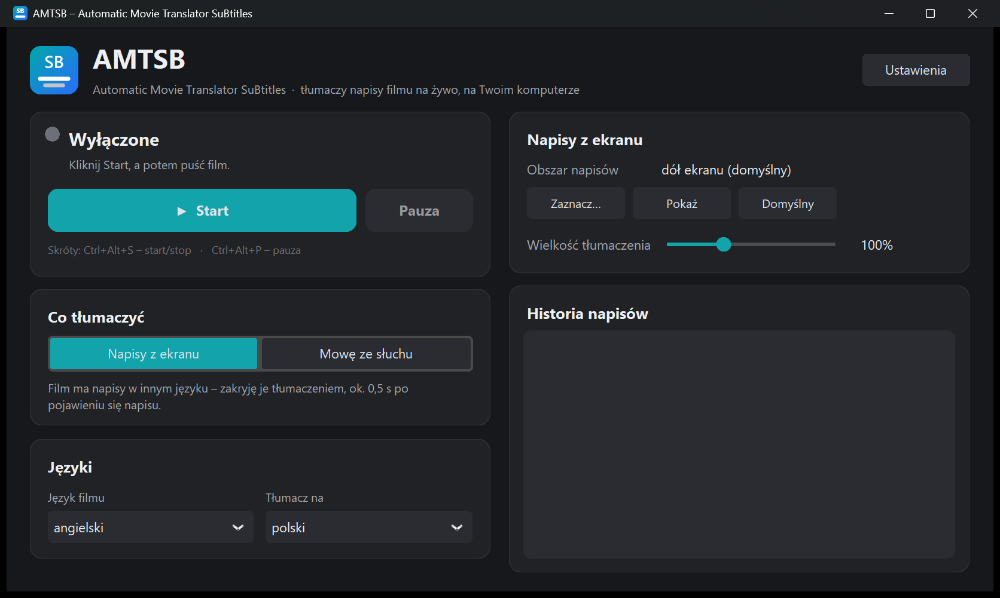
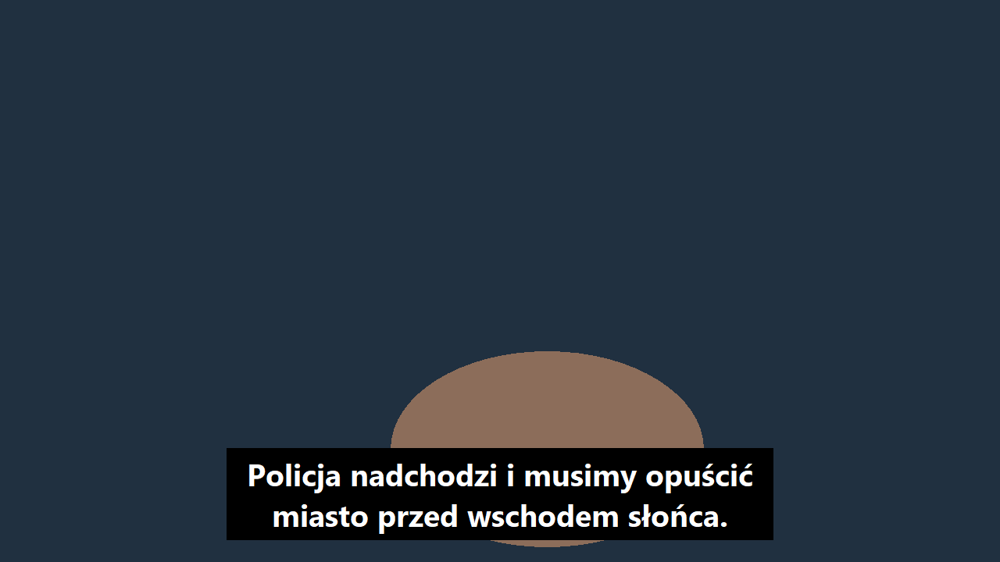

# AMTSB – Automatic Movie Translator SuBtitles

**English** · [Polski](README.md)

**Live** subtitle translation over any player: Netflix, YouTube, VLC, a web browser,
also in full screen. Runs locally on Windows, macOS and Linux.

> Finished files (`.srt` subtitles or a movie with subtitles) are made by the companion app
> **AMT – Automatic Movie Translator**.

## Two modes

### 1. Subtitles from the screen (recommended)
When the movie has subtitles, but in another language (e.g. English):

- every 0.1 s it captures the subtitle area and reads the text (OCR);
- it covers the original with a **black bar** showing the translation,
  about **0.3–0.6 s** after the subtitle appears;
- the bar is invisible to screen capture, so the program still sees the original underneath,
  and clicks pass through the bar to the player;
- it recognizes white outlined subtitles, subtitles on a black background, yellow ones,
  left-aligned ones, and dialogue ("- …" on two lines).

### 2. Speech by ear
When the movie has no subtitles at all:

- it listens to the computer's audio, recognizes speech (Whisper) and shows translated subtitles at the bottom of the screen;
- the delay is about 2–3 s, because the program has to hear the whole sentence first;
- subtitles can be dragged with the mouse, resized with the mouse wheel, and right-click opens a menu.

## Keyboard shortcuts

They work in any program, also when the movie is in full screen:

| Shortcut | Action |
|---|---|
| `Ctrl+Alt+S` (macOS: `Ctrl+Option+S`) | start / stop |
| `Ctrl+Alt+P` (macOS: `Ctrl+Option+P`) | pause / resume |

## Installation and launch

You need [Python 3.11 or 3.12](https://www.python.org/downloads/) and about 1.5–2.5 GB of disk space
(shared with AMT). Download the repository (**Code → Download ZIP**) and unpack it.

| System | How to start |
|---|---|
| **Windows 10 (2004+) / 11** | double-click **`AMTSB.exe`** (app icon) |
| **macOS** | double-click **`AMTSB.app`** (app icon) or `AMTSB.command`. The first time: right-click → *Open*. |
| **Linux** | the first time run `bash amtsb.sh` in a terminal. After that AMTSB is in the applications menu (with icon). Before that: `sudo apt install python3 python3-venv python3-tk tesseract-ocr` |

On first launch the program installs the libraries in a visible window (a few minutes).

> **Windows SmartScreen:** `AMTSB.exe` is a small unsigned launcher, so after downloading it from the internet
> Windows may show "Windows protected your PC". Click *More info → Run anyway*.
> Its source code is in `launcher/launcher.cs` and `launcher/build.bat` rebuilds it. Instead of `AMTSB.exe`
> you can also use `AMTSB.bat`.

Then set *Movie language* (e.g. English) and *Translate to* (e.g. Polish), click **Start** and play the movie.
If the program picks up something other than subtitles or doesn't see them, click **Select…** and drag a rectangle
where the subtitles appear. The **Show** button displays the current area.

The window follows the display scaling set in the system. In **Settings** you can make it larger or smaller.

## Differences between systems

| | Windows | macOS | Linux |
|---|---|---|---|
| Reading subtitles (OCR) | Windows OCR | Apple Vision | Tesseract |
| The bar **covers** the original | ✔ | ✔¹ | – the translation appears **above** the original² |
| Computer audio (speech mode) | ✔ built in | via [BlackHole](https://existential.audio/blackhole/)³ | ✔ PulseAudio / PipeWire ("Monitor of …") |
| Keyboard shortcuts | ✔ | ✔ (*Accessibility* permission) | ✔ (X11) |

¹ macOS will ask for **Screen Recording** permission for Terminal/Python: *System Settings → Privacy
& Security → Screen Recording*. If your macOS version doesn't allow hiding a window from screen capture, AMTSB
switches to the "above the original" mode by itself.
² Linux doesn't allow hiding a window from screen capture, so the bar can't sit on top of the original –
the program would "see" it. On Wayland, screen capture and shortcuts may not work; an X11 session is best.
³ macOS doesn't give programs access to the computer's audio. Install the free BlackHole, set it as the output
(or a multi-output device) and choose it in AMTSB as the audio source.

Test status: everything is tested on Windows. The macOS and Linux versions are ready but have not yet been
checked on a real Mac or Linux computer.

## Limitations

- Screen mode reads light-colored subtitles in the Latin alphabet best. Other alphabets need an OCR module for that
  language (Windows: an additional system language, Linux: e.g. `tesseract-ocr-rus`).
- The bar can't cover a game or player in *exclusive* full screen. Regular full screen in a browser,
  VLC or the Netflix app works.
- The translation is machine-made: it sometimes gets grammatical gender wrong or translates an idiom literally.

## How it works

| Step | Tool |
|---|---|
| Capturing the screen area | [mss](https://github.com/BoboTiG/python-mss) |
| Reading subtitles (OCR) | Windows.Media.Ocr (PyWinRT), Apple Vision (PyObjC), Tesseract (pytesseract) |
| Hiding the bar from screen capture | Windows: `SetWindowDisplayAffinity`, macOS: `NSWindow.sharingType` |
| Computer audio | PyAudioWPatch (Windows, WASAPI loopback), soundcard (macOS, Linux) |
| Speech recognition | [faster-whisper](https://github.com/SYSTRAN/faster-whisper) |
| Translation | [NLLB-200](https://ai.meta.com/research/no-language-left-behind/) (CTranslate2) |
| Window | [CustomTkinter](https://github.com/TomSchimansky/CustomTkinter) |

## Files

Libraries, models, settings (`amtsb.json`) and the log (`amtsb.log`) are in `~/.amt` (Windows: `%USERPROFILE%\.amt`).
A different folder can be set with the `AMT_HOME` environment variable.

## Model and library licenses

- Whisper (OpenAI), faster-whisper, CTranslate2, CustomTkinter, mss, PyWinRT, PyAudioWPatch, soundcard, pynput: MIT / BSD
- PyObjC: MIT; Tesseract: Apache 2.0
- **NLLB-200 (Meta): CC-BY-NC 4.0, non-commercial use only**

The models are not part of the repository. The program downloads them from Hugging Face on first use.

## License

Program code: [GNU AGPL v3](LICENSE). Models and libraries have their own licenses (see above).

## Contact

If you have any questions, please write to: blazejstosio@sinusoide.pl
