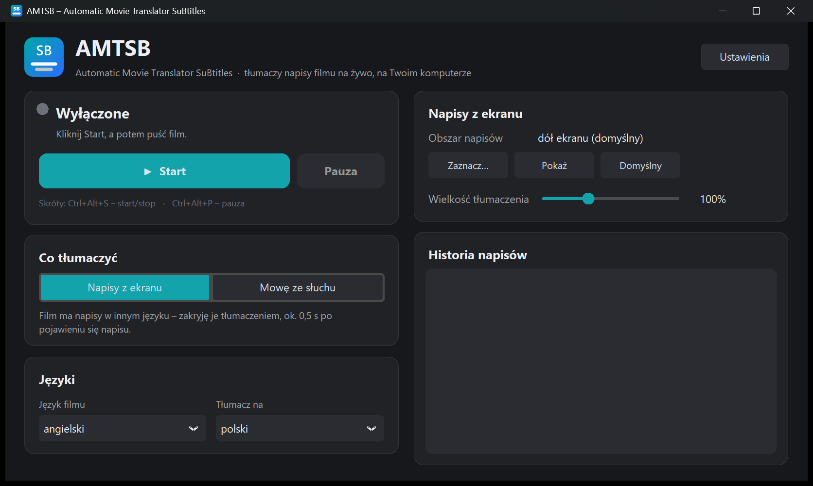
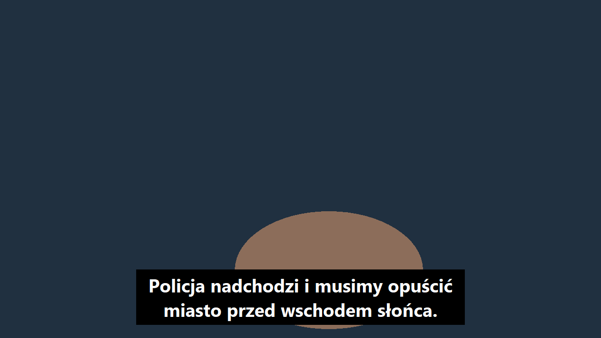

# AMTSB – Automatic Movie Translator SuBtitles

[English](README.en.md) · **Polski**

Tłumaczenie napisów **na żywo**, nad dowolnym odtwarzaczem: Netflix, YouTube, VLC,
przeglądarka, także w pełnym ekranie. Działa lokalnie w Windows, macOS i Linuksie.

> Gotowe pliki (napisy `.srt` albo film z napisami) robi siostrzany program
> **AMT – Automatic Movie Translator**.

## Dwa tryby

### 1. Napisy z ekranu (zalecany)
Gdy film ma napisy, ale w innym języku (np. angielskie):

- co 0,1 s robi zrzut obszaru napisów i odczytuje tekst (OCR);
- zakrywa oryginał **czarnym paskiem** i pokazuje na nim tłumaczenie,
  ok. **0,3–0,6 s** po pojawieniu się napisu;
- pasek jest niewidoczny dla zrzutów ekranu, więc program dalej widzi oryginał pod nim,
  a kliknięcia przechodzą przez pasek do odtwarzacza;
- rozpoznaje napisy białe z obwódką, na czarnym tle i żółte, a także dialogi („- …” w dwóch liniach).

### 2. Mowa ze słuchu
Gdy film nie ma żadnych napisów:

- słucha dźwięku z komputera, rozpoznaje mowę (Whisper) i pokazuje przetłumaczone napisy na dole ekranu;
- opóźnienie wynosi ok. 2–3 s, bo program musi najpierw usłyszeć całe zdanie;
- napisy można przeciągać myszką, kółkiem zmieniać ich wielkość, a prawy klik otwiera menu.

## Skróty klawiszowe

Działają w każdym programie, także gdy film jest na pełnym ekranie:

| Skrót | Działanie |
|---|---|
| `Ctrl+Alt+S` (macOS: `Ctrl+Option+S`) | start / stop |
| `Ctrl+Alt+P` (macOS: `Ctrl+Option+P`) | pauza / wznów |

## Instalacja i uruchomienie

Potrzebny jest [Python 3.11 lub 3.12](https://www.python.org/downloads/) oraz ok. 1,5–2,5 GB miejsca
(wspólne z AMT). Pobierz repozytorium (**Code → Download ZIP**) i rozpakuj.

| System | Uruchomienie |
|---|---|
| **Windows 10 (2004+) / 11** | dwuklik na **`AMTSB.exe`** (ikona aplikacji) |
| **macOS** | dwuklik na **`AMTSB.app`** (ikona aplikacji) albo `AMTSB.command`. Za pierwszym razem: prawy klik → *Otwórz*. |
| **Linux** | za pierwszym razem `bash amtsb.sh` w terminalu. Potem AMTSB jest w menu aplikacji (z ikoną). Wcześniej: `sudo apt install python3 python3-venv python3-tk tesseract-ocr` |

Przy pierwszym uruchomieniu program zainstaluje biblioteki w widocznym oknie (kilka minut).

> **Windows SmartScreen:** `AMTSB.exe` to mały program startowy bez podpisu cyfrowego, więc po pobraniu z internetu
> Windows może pokazać „System Windows ochronił ten komputer”. Kliknij *Więcej informacji → Uruchom mimo to*.
> Kod źródłowy jest w `launcher/launcher.cs`, a `launcher/build.bat` buduje go od nowa. Zamiast `AMTSB.exe`
> możesz też używać `AMTSB.bat`.

Potem ustaw *Język filmu* (np. angielski) i *Tłumacz na* (np. polski), kliknij **Start** i puść film.
Jeśli program łapie coś poza napisami albo ich nie widzi, kliknij **Zaznacz…** i przeciągnij prostokąt
w miejscu napisów. Przycisk **Pokaż** wyświetla aktualny obszar.

Okno dopasowuje się do powiększenia ekranu ustawionego w systemie. W **Ustawieniach** można je dodatkowo
powiększyć lub pomniejszyć.

## Różnice między systemami

| | Windows | macOS | Linux |
|---|---|---|---|
| Odczyt napisów (OCR) | OCR Windows | Apple Vision | Tesseract |
| Pasek **zakrywa** oryginał | ✔ | ✔¹ | – tłumaczenie pojawia się **nad** oryginałem² |
| Dźwięk z komputera (tryb ze słuchu) | ✔ wbudowany | przez [BlackHole](https://existential.audio/blackhole/)³ | ✔ PulseAudio / PipeWire („Monitor of …”) |
| Skróty klawiszowe | ✔ | ✔ (zgoda na *Dostępność*) | ✔ (X11) |

¹ macOS poprosi o zgodę na **Nagrywanie ekranu** dla Terminala/Pythona: *Ustawienia systemowe → Prywatność
i ochrona → Nagrywanie ekranu*. Jeśli Twoja wersja macOS nie pozwala ukryć okna przed zrzutem, AMTSB sam
przełączy się na tryb „nad oryginałem”.
² Linux nie pozwala ukryć okna przed zrzutem ekranu, więc pasek nie może leżeć na oryginale. Program i tak by
go „widział”. Na Waylandzie zrzuty ekranu i skróty mogą nie działać; najlepiej użyć sesji X11.
³ macOS nie udostępnia programom dźwięku z komputera. Zainstaluj darmowe BlackHole, ustaw je jako wyjście
(albo urządzenie wielowyjściowe) i wybierz je w AMTSB jako źródło dźwięku.

Stan testów: na Windows wszystko jest przetestowane. Wersje na macOS i Linuksa są gotowe, ale nie były jeszcze
sprawdzone na prawdziwym Macu ani komputerze z Linuksem.

## Ograniczenia

- Tryb z ekranu najlepiej czyta jasne napisy w alfabecie łacińskim. Inne alfabety wymagają modułu OCR dla danego
  języka (Windows: dodatkowy język w systemie, Linux: np. `tesseract-ocr-rus`).
- Pasek nie przykryje gry ani odtwarzacza w trybie *wyłącznego* pełnego ekranu. Zwykły pełny ekran
  przeglądarki, VLC czy aplikacji Netflix działa.
- Tłumaczenie jest maszynowe: czasem pomyli rodzaj („byłeś/byłaś”) albo przetłumaczy idiom dosłownie.

## Jak to działa

| Krok | Narzędzie |
|---|---|
| Zrzut obszaru ekranu | [mss](https://github.com/BoboTiG/python-mss) |
| Odczyt napisów (OCR) | Windows.Media.Ocr (PyWinRT), Apple Vision (PyObjC), Tesseract (pytesseract) |
| Ukrycie paska przed zrzutem | Windows: `SetWindowDisplayAffinity`, macOS: `NSWindow.sharingType` |
| Dźwięk z komputera | PyAudioWPatch (Windows, WASAPI loopback), soundcard (macOS, Linux) |
| Rozpoznawanie mowy | [faster-whisper](https://github.com/SYSTRAN/faster-whisper) |
| Tłumaczenie | [NLLB-200](https://ai.meta.com/research/no-language-left-behind/) (CTranslate2) |
| Okno | [CustomTkinter](https://github.com/TomSchimansky/CustomTkinter) |

## Pliki

Biblioteki, modele, ustawienia (`amtsb.json`) i log (`amtsb.log`) są w `~/.amt` (Windows: `%USERPROFILE%\.amt`).
Inny folder można ustawić zmienną środowiskową `AMT_HOME`.

## Licencje modeli i bibliotek

- Whisper (OpenAI), faster-whisper, CTranslate2, CustomTkinter, mss, PyWinRT, PyAudioWPatch, soundcard, pynput: MIT / BSD
- PyObjC: MIT; Tesseract: Apache 2.0
- **NLLB-200 (Meta): CC-BY-NC 4.0, tylko do użytku niekomercyjnego**

Modele nie są częścią repozytorium. Program pobiera je z Hugging Face przy pierwszym użyciu.

## Licencja

Kod programu: [GNU AGPL v3](LICENSE). Modele i biblioteki mają własne licencje (patrz wyżej).

## Kontakt

W przypadku pytań proszę pisać na adres: blazejstosio@sinusoide.pl
